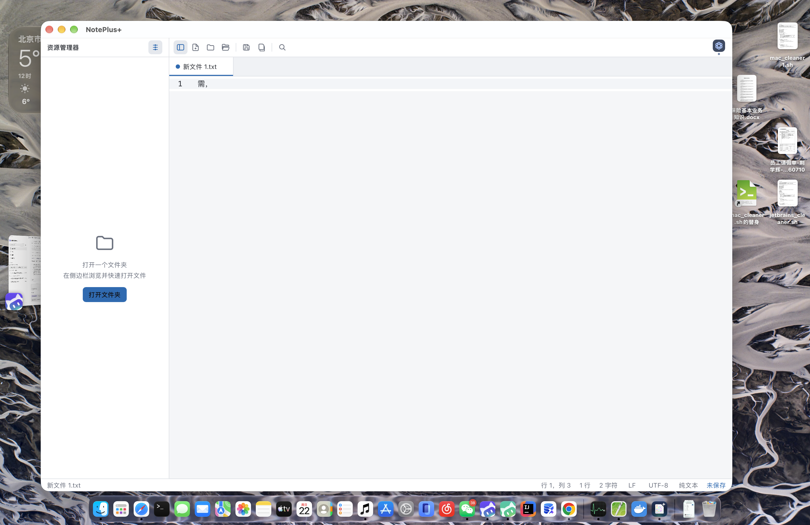

# NotePlus+

**English** | [简体中文](README.zh-CN.md)

<div align="center">

**A lightweight, efficient code editor for macOS**

Tauri 2 · Vue 3 · CodeMirror 6 · ~5 MB installer


</div>

NotePlus+ is a lightweight Notepad++-style code editor built with Tauri 2 — no bundled Chromium, only ~5 MB installed. It offers multi-tab editing, a file tree, a standalone find window, dark/light themes (including native follow-system), and a modern split-pane layout.

---

## Table of Contents

- [Why NotePlus+?](#why-noteplus)
- [Features](#features)
- [Keyboard Shortcuts](#keyboard-shortcuts)
- [Install](#install)
- [Getting Started](#getting-started)
- [Tech Stack](#tech-stack)
- [Roadmap](#roadmap)
- [License](#license)

## Why NotePlus+?

- 🪶 **~5 MB, zero runtime burden** — no embedded browser engine, no Java/Python dependencies; a single `.app` just runs (macOS 10.15+).
- 🎨 **Native-grade dark/light themes** — theming goes beyond CSS: window titlebar appearance is synced from the Rust side; "Follow System" uses native appearance detection plus event broadcasting, picking up system switches within ~1.5 s, with the find window syncing too.
- 🪟 **Modern split-pane layout** — sidebar, editor and status bar become independent rounded panes with gaps; tabs turn into accent-colored pills. Switch back to the classic compact layout anytime.
- 🔍 **Standalone find window** — find/replace run in a separate native window, two-way synced with the editor's highlights and match positions; jump with `⌘G` / `⇧⌘G`.
- 🧩 **Settings with live preview** — the settings dialog uses a draft model: changes preview instantly, "Apply" commits, "Close" discards unapplied previews automatically.
- 🧠 **CodeMirror 6 core** — multi-language syntax highlighting, autocompletion, bracket matching, linting and search, all modular and loaded on demand.

## Features

### Editor
- Powered by CodeMirror 6: syntax highlighting, context-aware autocompletion, bracket matching, active-line highlight, line numbers, cursor position indicator
- Built-in languages: JavaScript / TypeScript, Vue, HTML, CSS, JSON, Markdown, Python, Rust, Go, Java, C/C++, PHP, SQL, XML, YAML and more
- Independent editor font size control (`⌘+` / `⌘-` / `⌘0`), separate from UI zoom
- Word-wrap toggle, unsaved-change indicator (yellow dot), save confirmation before closing

### Files & Tabs
- Multi-tab editing: create, switch, middle-click to close, `⇧⌘W` to close all
- File tree sidebar: browse and open files after opening a folder
- Drag-and-drop: drop a file onto the window to open it
- Welcome page: open file/folder entry points and a shortcut cheat sheet when no tab is open

### Find & Replace
- Standalone find window (`⌘F`): find, replace, highlight all matches
- Two-way sync between editor and find window; `⌘G` / `⇧⌘G` to jump between matches
- Find history persisted locally; `Esc` closes instantly
- The find window auto-hides when the app loses focus (native `hidesOnDeactivate`)

### Appearance
- Themes: light / dark / **follow system** (native-grade real-time)
- 3 accent themes: cobalt blue / indigo / teal, applied across highlights, tab pills and buttons
- Corner-radius presets (none / small / large) applied globally; UI zoom from 80% to 140%
- Font-smoothing toggle; system / monospace UI font switch

### Layout
- **Modern split-pane**: sidebar / editor / status bar become independent rounded panes; tabs become accent pills (file icon + always-visible close button)
- **Classic compact**: flush layout with thin separators
- Both layouts preview live and switch instantly

<div align="center">

<table>
<tr>
<td></td>
<td></td>
</tr>
<tr><td align="center">Modern split-pane</td><td align="center">Classic compact</td></tr>
</table>

</div>

### Settings Center
- `⌘,` opens a dbx-style large modal: left navigation (Appearance / Updates / About) + right form + bottom action bar
- Every appearance option previews live; "Apply" / "Apply & Close" commit, while "Close" / `Esc` / clicking the backdrop discards unapplied changes
- Updates: auto-check toggle, stable/preview channels, manual check


### Status Bar
- Current file, line/column, line & character count, line ending (LF / CRLF), file encoding, language mode

## Keyboard Shortcuts

| Shortcut | Action |
| --- | --- |
| `⌘S` / `⇧⌘S` / `⌥⌘S` | Save / Save As / Save All |
| `⌘N` | New tab |
| `⌘O` / `⇧⌘O` | Open file / Open folder |
| `⌘W` / `⇧⌘W` | Close tab / Close all tabs |
| `⌘F` | Open find window |
| `⌘G` / `⇧⌘G` | Next / previous match |
| `⌘=` / `⌘-` / `⌘0` | Zoom in / out / reset editor font size |
| `⌘B` | Toggle sidebar |
| `⌘,` | Open settings |
| `Esc` | Close dialog / find window |

## Install

Install directly from the build artifacts (currently v0.1.1):

```bash
# Build artifacts are located at
src-tauri/target/release/bundle/macos/NotePlus+.app
src-tauri/target/release/bundle/dmg/NotePlus+_0.1.1_aarch64.dmg
```

Drag `NotePlus+.app` into Applications, or mount the dmg and drag to install.

## Getting Started

### Prerequisites

- Node.js >= 20
- pnpm >= 9
- Rust >= 1.77 (with `cargo`)
- macOS 10.15+ (other platforms require adapting the Tauri toolchain)

### Development

```bash
pnpm install          # Install frontend dependencies
pnpm tauri dev        # Start the desktop dev environment (Vite HMR + Tauri window)
```

Frontend-only debugging in a browser (no Tauri commands; theme falls back to media queries):

```bash
pnpm dev              # http://localhost:1420
```

### Build

```bash
pnpm tauri build      # Produces .app and .dmg under src-tauri/target/release/bundle/
```

`vue-tsc --noEmit` type checking runs automatically before the build.

### Rust-side capabilities

Besides regular file IO / directory-tree commands, `src-tauri/src/lib.rs` provides:

- `get_system_dark` / `system:theme-changed` event — native detection and broadcasting of the macOS appearance (WKWebView's `prefers-color-scheme` is unreliable under Tauri)
- `open_find_window` / `close_find_window` / `set_find_theme` — standalone find window creation, Esc closing and titlebar theme sync
- Native `hidesOnDeactivate` on the find window, so it hides with the app

## Tech Stack

| Layer | Technology |
| --- | --- |
| Framework | Tauri 2 |
| Frontend | Vue 3 + TypeScript |
| UI | Tailwind CSS 4 + in-house components (settings dialog / confirm dialog / toasts) |
| Editor | CodeMirror 6 (`@codemirror/lang-*` packages) |
| Backend | Rust (file IO, window management, system appearance detection) |
| State | Vue reactive stores (settings / tabs / file tree / UI / toasts) |

## Roadmap

- [ ] Split editor panes (side-by-side editing)
- [ ] File tree rename / create / delete
- [ ] Real update distribution (the Updates page is currently a UI demo)
- [ ] Multi-language UI (currently Simplified Chinese)

## License

No open-source license is attached yet; all rights reserved by default. Apache-2.0 or MIT is recommended if open-sourcing.
