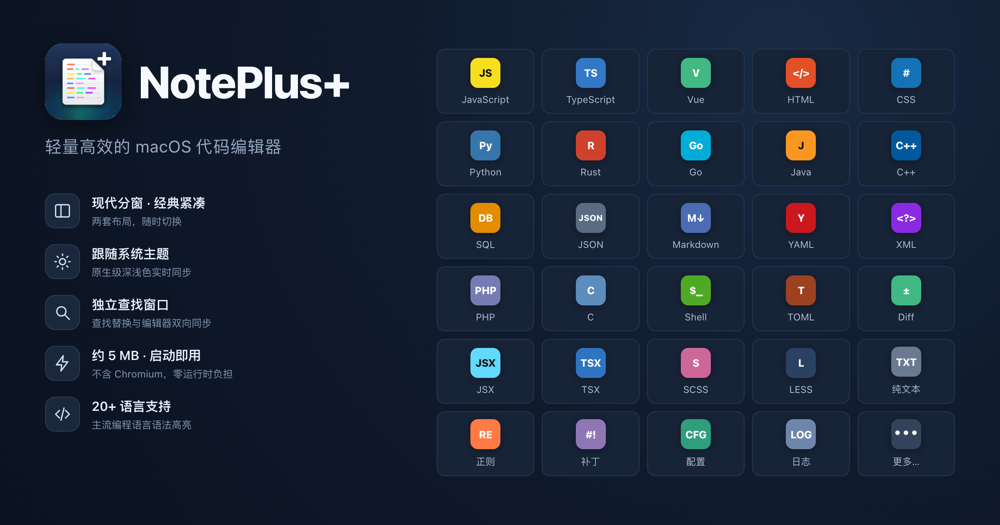

# NotePlus+

**English** | [简体中文](README.zh-CN.md)

<div align="center">

**Light as a feather, fast as the wind — the next-generation editor for macOS & Windows**

Tauri 2 · Vue 3 · CodeMirror 6 · ~5 MB installer · 3 languages



</div>

NotePlus+ is a lightweight Notepad++-style code editor built with Tauri 2 — no bundled Chromium, only ~5 MB installed. It offers multi-tab editing, a file tree, a standalone find window, dark/light themes (including native follow-system), a modern split-pane layout, three UI languages, and real in-app updates.

---

## Table of Contents

- [Why NotePlus+?](#why-noteplus)
- [Features](#features)
- [Keyboard Shortcuts](#keyboard-shortcuts)
- [Getting Started](#getting-started)
- [Release](#release)
- [Tech Stack](#tech-stack)
- [Roadmap](#roadmap)
- [License](#license)

## Why NotePlus+?

- 🪶 **~5 MB, zero runtime burden** — no embedded browser engine, no Java/Python dependencies; a single binary just runs (macOS 10.15+ / Windows 10+).
- 🎨 **Native-grade dark/light themes** — theming goes beyond CSS: window titlebar appearance is synced from the Rust side; "Follow System" uses native appearance detection plus event broadcasting, picking up system switches within ~1.5 s, with the find window syncing too.
- 🪟 **Modern split-pane layout** — sidebar, editor and status bar become independent rounded panes with gaps; tabs turn into accent-colored pills. Switch back to the classic compact layout anytime.
- 🔍 **Standalone find window** — find/replace run in a separate native window, two-way synced with the editor's highlights and match positions; jump with `⌘G` / `Ctrl+G`.
- 🧩 **Settings with live preview** — the settings dialog uses a draft model: changes preview instantly, "Apply" commits, "Close" discards unapplied previews automatically.
- 🌍 **Three languages, instant switching** — Simplified Chinese / Traditional Chinese / English, including tooltips, dialogs, shortcut hints and the native find-window title. macOS system dialogs follow the in-app language after restart.
- ⚡ **Real in-app updates** — release notes, stable/preview channels, background download and install of `.dmg` / `.msi` / `.exe` artifacts, plus per-platform asset picking.
- 🧠 **CodeMirror 6 core** — multi-language syntax highlighting, autocompletion, bracket matching, linting and search, all modular and loaded on demand.

## Features

### Editor
- Powered by CodeMirror 6: syntax highlighting, context-aware autocompletion, bracket matching, active-line highlight, line numbers, cursor position indicator
- Built-in languages: JavaScript / TypeScript, Vue, HTML, CSS, JSON, Markdown, Python, Rust, Go, Java, C/C++, PHP, SQL, XML, YAML and more
- Independent editor font size control (`⌘+` / `Ctrl+`), separate from UI zoom
- Word-wrap toggle, unsaved-change indicator (yellow dot), save confirmation before closing
- Right-click opens a custom menu (undo / redo / cut / copy / paste / find) without the native "select word under cursor" behavior; the caret stays visible even at end of line

### Files & Tabs
- Multi-tab editing: create, switch, middle-click to close, close all tabs
- File tree sidebar: browse and open files after opening a folder; "Reveal in Finder" on macOS / "Reveal in Explorer" on Windows
- Drag-and-drop: drop a file onto the window to open it
- Welcome page: open file/folder entry points and a shortcut cheat sheet when no tab is open

### Find & Replace
- Standalone find window (`⌘F` / `Ctrl+F`): find, replace, highlight all matches
- Two-way sync between editor and find window; `⌘G` / `Ctrl+G` to jump between matches
- Find history persisted locally; `Esc` closes instantly; window title follows the UI language
- The find window auto-hides when the app loses focus on macOS (native `hidesOnDeactivate`)

### Appearance
- Themes: light / dark / **follow system** (native-grade real-time)
- 7 accent colors, applied across highlights, tab pills and buttons
- Corner-radius presets (none / small / large) applied globally; UI zoom from 80% to 140%
- Font-smoothing toggle; system / monospace UI font switch
- Brief animated splash on launch with a gradient logo, brand name and localized slogan

### Status Bar
- Current file, line/column, line & character count, line ending (LF / CRLF), file encoding, language mode

## Keyboard Shortcuts

`⌘` is macOS; `Ctrl` is Windows. The app accepts both modifier keys on either platform as a fallback.

| macOS | Windows | Action |
| --- | --- | --- |
| `⌘+S` / `⇧+⌘+S` / `⌥⌘S` | `Ctrl+S` / `Ctrl+Shift+S` / `Ctrl+Alt+S` | Save / Save As / Save All |
| `⌘+N` | `Ctrl+N` | New tab |
| `⌘+O` / `⇧+⌘+O` | `Ctrl+O` / `Ctrl+Shift+O` | Open file / Open folder |
| `⌘+W` / `⇧+⌘+W` | `Ctrl+W` / `Ctrl+Shift+W` | Close tab / Close all tabs |
| `⌘+F` | `Ctrl+F` | Open find window |
| `⌘+G` / `⇧+⌘+G` | `Ctrl+G` / `Ctrl+Shift+G` | Next / previous match |
| `⌘+` / `⌘-` / `⌘0` | `Ctrl+=` / `Ctrl+-` / `Ctrl+0` | Zoom in / out / reset editor font size |
| `⌘+B` | `Ctrl+B` | Toggle sidebar |
| `⌘+,` | `Ctrl+,` | Open settings |
| `⇧+⌥+F` | `Shift+Alt+F` | Format JSON |
| `Esc` | `Esc` | Close dialog / find window |


## Getting Started

### Prerequisites

- Node.js >= 20
- pnpm >= 9
- Rust >= 1.77 (with `cargo`)
- macOS 10.15+ or Windows 10+; Windows builds require the MSVC toolchain

### Development

```bash
pnpm install          # Install frontend dependencies
pnpm tauri dev        # Start the desktop dev environment (Vite HMR + Tauri window)
```

Frontend-only debugging in a browser (no Tauri commands; theme falls back to media queries):

```bash
pnpm dev              # http://localhost:1420
```

### Build

```bash
pnpm tauri build      # macOS: .app + .dmg; Windows: NSIS .exe + .msi
```

`vue-tsc --noEmit` type checking runs automatically before the build. Platform configuration is merged from `src-tauri/tauri.conf.json` plus `tauri.windows.conf.json` (borderless window with custom controls and Windows bundle targets).

### Rust-side capabilities

Besides regular file IO / directory-tree commands, `src-tauri/src/lib.rs` provides:

- `get_system_dark` / `system:theme-changed` event — native appearance detection and broadcasting (WKWebView's `prefers-color-scheme` is unreliable under Tauri)
- `open_find_window` / `close_find_window` / `set_find_theme` — standalone find window creation, Esc closing and titlebar theme sync; its title is passed in from the frontend to follow the UI language
- Platform branches for Finder / Explorer reveal, external links, update installation and close-window behavior
- macOS Dock icon styles and hide-on-close; Windows closes the window to quit

## Release

Publish a new version with one command:

```bash
pnpm release
```

What happens:

1. `scripts/release.mjs` — takes `src-tauri/tauri.conf.json` as the source of truth, bumps the patch version and syncs it into `package.json` and `src-tauri/Cargo.toml`
2. `tauri build` — type-checks (`vue-tsc`), applies `scripts/post-build.sh` on macOS (localization declaration, ad-hoc signing, dmg rebuild)
3. `scripts/upload-release.mjs` — uploads the macOS artifacts to GitHub Release and Gitee Release under tag `v<version>`
4. `.github/workflows/build-windows.yml` — triggered by the tag, builds on `windows-latest` and uploads `.exe` / `.msi` to both releases

To re-upload existing artifacts without rebuilding:

```bash
pnpm release:upload
```

Upload requires tokens (choose one; never commit them): environment variables `GH_TOKEN` / `GITEE_TOKEN`, or a local file `~/.noteplus-release.env`:

```env
GH_TOKEN=github_pat_xxx
GITEE_TOKEN=xxx
```

## Tech Stack

| Layer | Technology |
| --- | --- |
| Framework | Tauri 2 (macOS & Windows) |
| Frontend | Vue 3 + TypeScript |
| UI | Tailwind CSS 4 + in-house components (settings dialog / confirm dialog / toasts) |
| Editor | CodeMirror 6 (`@codemirror/lang-*` packages) |
| Backend | Rust (file IO, window management, system appearance detection) |
| State | Vue reactive stores (settings / tabs / file tree / UI / toasts) |
| I18n | In-house `t()` dictionary, zh-CN / zh-TW / en-US with `{param}` interpolation |

## Roadmap

- [ ] Split editor panes (side-by-side editing)
- [ ] File tree rename / create / delete
- [x] Real update distribution (release notes, channels, background download & install)
- [x] Multi-language UI (Simplified Chinese / Traditional Chinese / English)

## License

No open-source license is attached yet; all rights reserved by default. Apache-2.0 or MIT is recommended if open-sourcing.
