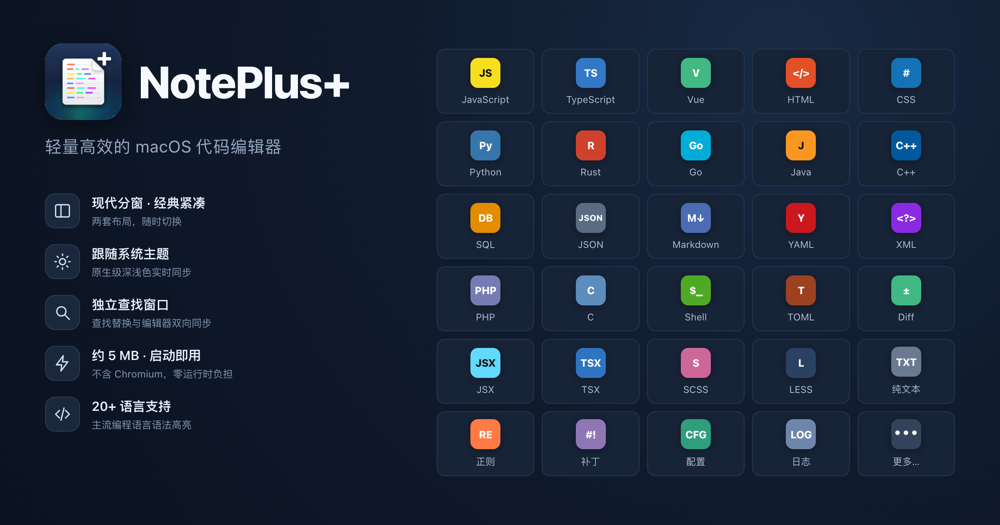
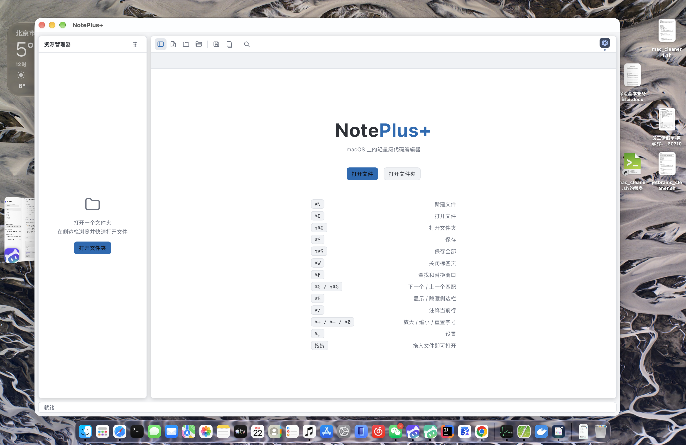
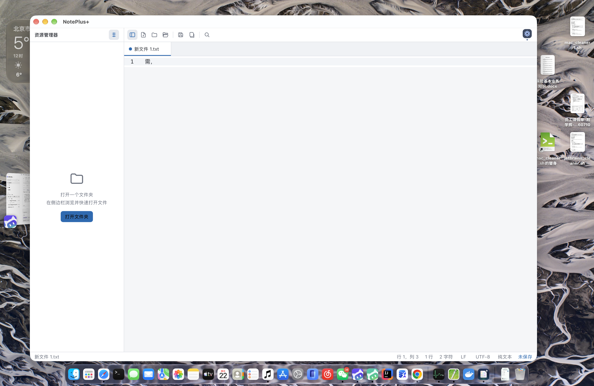
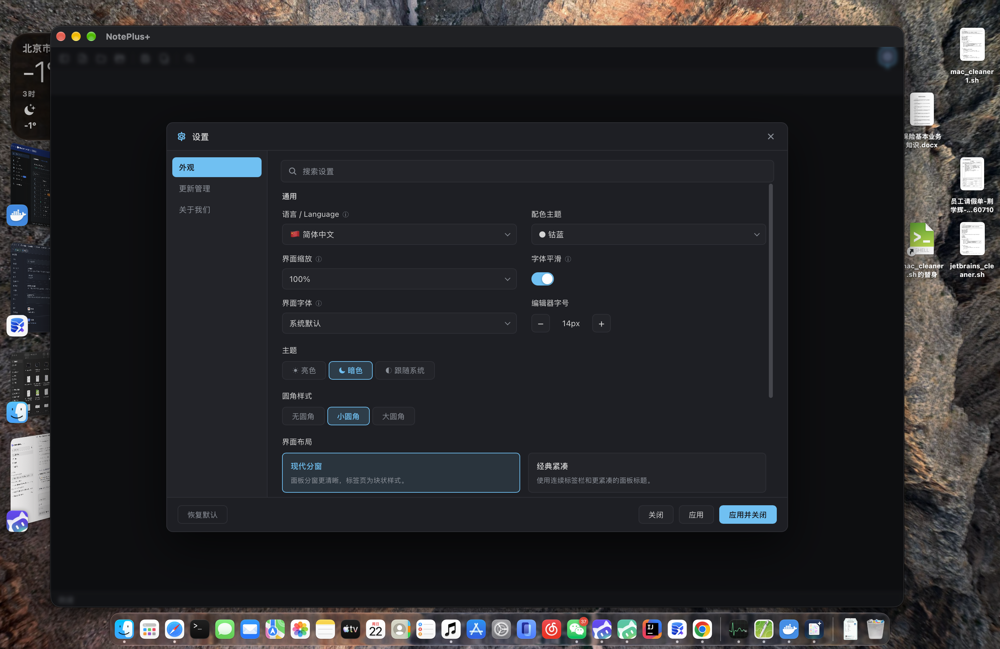

# NotePlus+

English | **简体中文**

<div align="center">

**轻量高效的 macOS 代码编辑器**

Tauri 2 · Vue 3 · CodeMirror 6 · 约 5 MB 安装包



</div>

NotePlus+ 是一款 Notepad++ 风格的轻量级代码编辑器，使用 Tauri 2 构建，不内置 Chromium，安装包仅约 5 MB。提供多标签编辑、文件树、独立查找窗口、深浅色主题（含跟随系统）、现代分窗布局等特性。

---

## 目录

- [Why NotePlus+?](#why-noteplus)
- [Features](#features)
- [Keyboard Shortcuts](#keyboard-shortcuts)
- [Install](#install)
- [Getting Started](#getting-started)
- [Tech Stack](#tech-stack)
- [Roadmap](#roadmap)
- [License](#license)

## Why NotePlus+?

- 🪶 **约 5 MB，零运行时负担** — 无内置浏览器内核、无 Java / Python 依赖，单一 `.app` 即可运行（macOS 10.15+）。
- 🎨 **原生观感的深浅色主题** — 主题切换不止改 CSS：窗口标题栏外观由 Rust 侧同步设置；「跟随系统」通过原生外观检测 + 事件广播实现，系统切换深浅色后约 1.5 秒内自动跟随，查找窗口一并同步。
- 🪟 **现代分窗布局** — 侧边栏、编辑区、状态栏成为带间隙的独立圆角窗格，标签页变为强调色胶囊；随时可切回经典紧凑布局。
- 🔍 **独立查找窗口** — 查找 / 替换在独立原生窗口中进行，与编辑器双向同步高亮与匹配位置，支持 `⌘G` / `⇧⌘G` 快速跳转。
- 🧩 **设置即预览** — 设置弹框采用草稿模型：改动实时预览，「应用」提交、「关闭」自动丢弃未应用的预览。
- 🧠 **CodeMirror 6 内核** — 多语言语法高亮、自动补全、括号匹配、Lint、搜索，均为按需加载的模块化能力。

## Features

### 编辑器
- 基于 CodeMirror 6：语法高亮、基于上下文的自动补全、括号匹配、活动行高亮、行号、当前行/列指示
- 内置语言支持：JavaScript / TypeScript、Vue、HTML、CSS、JSON、Markdown、Python、Rust、Go、Java、C/C++、PHP、SQL、XML、YAML 等
- 编辑器字号独立调节（`⌘+` / `⌘-` / `⌘0`），与界面缩放相互独立
- 自动换行开关、未保存更改标记（黄色圆点）、关闭前保存确认

### 文件与标签页
- 多标签编辑：新建、切换、中键关闭、`⇧⌘W` 一键关闭全部
- 文件树侧边栏：打开文件夹后浏览并快速打开文件
- 拖拽即开：将文件拖入窗口即可打开
- 欢迎页：无标签时提供打开文件 / 文件夹入口与快捷键速查

### 查找与替换
- 独立查找窗口（`⌘F`）：查找、替换、高亮全部匹配
- 编辑器与查找窗口双向同步，`⌘G` / `⇧⌘G` 在匹配间跳转
- 查找历史本地持久化，`Esc` 即关即走
- 查找窗口随应用失去焦点自动隐藏（macOS 原生 `hidesOnDeactivate`）

### 外观个性化
- 主题：亮色 / 暗色 / **跟随系统**（原生级实时跟随）
- 3 种配色主题：钴蓝 / 靛蓝 / 青绿，贯穿界面高亮、标签胶囊、按钮
- 圆角样式（无 / 小 / 大）全局联动，界面缩放 80%–140%
- 字体平滑开关、系统 / 等宽 UI 字体切换

### 界面布局
- **现代分窗**：侧边栏 / 编辑区 / 状态栏成为独立圆角窗格，标签页为强调色胶囊（文件图标 + 常显关闭按钮）
- **经典紧凑**：贴合布局、细边框分隔的紧凑形态
- 两种布局实时预览、即点即换

<div align="center">

<table>
<tr>
<td></td>
<td></td>
</tr>
<tr><td align="center">现代分窗</td><td align="center">经典紧凑</td></tr>
</table>

</div>

### 设置中心
- `⌘,` 打开 dbx 风格大模态设置窗口：左侧导航（外观 / 更新管理 / 关于我们）+ 右侧表单 + 底部按钮栏
- 全部外观项实时预览；「应用」「应用并关闭」提交，「关闭」/ `Esc` / 点击遮罩丢弃未应用的更改
- 更新管理：自动检查开关、稳定 / 预览渠道、手动检查更新



### 状态栏
- 当前文件、行列位置、行数与字符数、换行符（LF / CRLF）、文件编码、语言模式

## Keyboard Shortcuts

| 快捷键 | 功能 |
| --- | --- |
| `⌘S` / `⇧⌘S` / `⌥⌘S` | 保存 / 另存为 / 全部保存 |
| `⌘N` | 新建标签 |
| `⌘O` / `⇧⌘O` | 打开文件 / 打开文件夹 |
| `⌘W` / `⇧⌘W` | 关闭标签 / 关闭全部标签 |
| `⌘F` | 打开查找窗口 |
| `⌘G` / `⇧⌘G` | 下一个 / 上一个匹配 |
| `⌘=` / `⌘-` / `⌘0` | 放大 / 缩小 / 重置编辑器字号 |
| `⌘B` | 显示 / 隐藏侧边栏 |
| `⌘,` | 打开设置 |
| `Esc` | 关闭弹框 / 查找窗口 |

## Install

从 release 产物直接安装（当前为 v1.0.0）：

```bash
# 构建产物位于
src-tauri/target/release/bundle/macos/NotePlus+.app
src-tauri/target/release/bundle/dmg/NotePlus+_1.0.0_aarch64.dmg
```

将 `NotePlus+.app` 拖入「应用程序」即可使用；dmg 双击挂载后拖拽安装。

## Getting Started

### 前置条件

- Node.js >= 20
- pnpm >= 9
- Rust >= 1.77（含 `cargo`）
- macOS 10.15+（其他平台需自行适配 Tauri 工具链）

### 开发

```bash
pnpm install          # 安装前端依赖
pnpm tauri dev        # 启动桌面开发环境（Vite 热更新 + Tauri 窗口）
```

仅前端调试（浏览器环境，无 Tauri 命令，主题会走媒体查询兜底）：

```bash
pnpm dev              # http://localhost:1420
```

### 构建

```bash
pnpm tauri build      # 产出 .app 与 .dmg，位于 src-tauri/target/release/bundle/
```

构建前会自动执行 `vue-tsc --noEmit` 类型检查。

### Rust 侧能力说明

`src-tauri/src/lib.rs` 除常规文件 IO / 目录树命令外，还包含：

- `get_system_dark` / `system:theme-changed` 事件 — 原生检测 macOS 外观并广播（WKWebView 的 `prefers-color-scheme` 在 Tauri 下不可靠）
- `open_find_window` / `close_find_window` / `set_find_theme` — 独立查找窗口的创建、Esc 关闭与标题栏主题同步
- 查找窗口原生 `hidesOnDeactivate`，随应用失焦隐藏

## Tech Stack

| 层级 | 技术 |
| --- | --- |
| 框架 | Tauri 2 |
| 前端 | Vue 3 + TypeScript |
| UI | Tailwind CSS 4 + 自研组件（设置弹框 / 确认框 / Toast） |
| 编辑器 | CodeMirror 6（`@codemirror/lang-*` 多语言包） |
| 后端 | Rust（文件 IO、窗口管理、系统外观检测） |
| 状态 | Vue reactive stores（设置 / 标签页 / 文件树 / UI / Toast） |

## Roadmap

- [ ] 编辑器分栏（左右对照编辑）
- [ ] 文件树重命名 / 新建 / 删除
- [ ] 真实更新分发（当前更新管理页为 UI 演示）
- [ ] 多语言界面（当前简体中文）

## License

本项目尚未附带开源许可证，默认保留所有权利。如需开源，建议采用 Apache-2.0 或 MIT。
